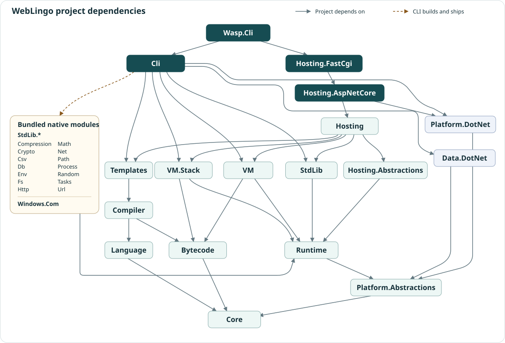

# WebLingo — Implementation

This document covers the WebLingo repository as a whole: the product, its documents, the layout and projects, the development environment, how the specification's decisions are handled, the architectural rules for code, source text and positions, building and testing (a finished task's checks included), licensing, known traps, the choices not to change without asking, and where the next tasks come from. The general rules for agents are in `AGENTS.md`, and how to work through the tasks in `TO-DO-INSTRUCTIONS.md`. The design itself is in the specification (section 2), and the state of the work is in `HANDOFF.md`.

Paths in this document start at the repository root.

------

# 1. Product

WebLingo is a JavaScript-inspired, native-oriented, cross-platform **server-side scripting language**, meant to combine the easy deployment of PHP and classic ASP with modern language semantics, secure defaults and efficient execution (specification, section 1).

- Scripts and modules are `.wlg` files; HTML pages with server-side WebLingo templates are `.wasp` files.
- Source is compiled to WLBC, a verified portable bytecode, and executed by the WebLingo VM.
- The language is JavaScript-inspired but does **not** promise ECMAScript compatibility.
- The compiler, VM, runtime and hosting are written first in C# on .NET 10. The long-term goal is to compile that same C# code with a Native C# compiler being developed separately, so that WebLingo runs without .NET and without a rewrite in C/C++. Native C# and WebLingo are separate languages and runtime systems.
- The engine and the platform services are independent of IIS, ASP.NET Core, FastCGI, Kestrel, Windows and Linux. IIS, through an ASP.NET Core adapter, is the first deployment target; a FastCGI host, for nginx and Apache, is built too (M0.19), and a standalone HTTP host is an architectural target.

The current state (specification, sections 9 and 15): a compiler and a VM, a register VM, for M0.6's subset and the language of the specification's sections 3.5 to 3.8 (statements, collections, classes and exceptions, and asynchrony), with source compiled and run, and the VM running its WLBC file; the stack VM it was compared with is gone, the owner having chosen the register VM (23 November 2026, WL-BC002), its last commit tagged `stack-vm-end`. `weblingo compile` writes bytecode as `.wlb` (specification, section 5.3); and pages (`.wasp`, section 13, M0.12.1), their includes (M0.12.2), components (M0.12.3) and layouts (M0.12.4), which `wasp`, WASP's command line, runs; hosting is being built (M0.14, the specification's section 9): WLHI's HTTP contracts (`WebLingo.Hosting.Abstractions`) and the host's core (`WebLingo.Hosting`), which serves an application's pages, and the platform layer is in part. `samples/HelloWorld`, `samples/Arithmetic` and `samples/Modules` run through `weblingo`, and `samples/SimpleWebsite` through `wasp`.

**Names** (specification, section 1): the project is **WebLingo** (formerly WebScript), its intended domain `weblingo.dev`, the solution `WebLingo.slnx`, the project and namespace roots `WebLingo`, the CLI executable `weblingo`, and that of WASP, Web Application Server Pages, the technology of templates for web servers (specification, section 13), `wasp`, `weblingo` being strictly the scripts' runner and `wasp` the web handler, which serves applications, locally and under IIS (the owner's decision, 16 November 2026); compiled bytecode is WLBC, WebLingo ByteCode, in `.wlb` files (the owner's request, 23 November 2026, in place of `.wlbr` for the register VM and `.wlbs` for the stack VM, which an earlier build's `.wlbr` still runs as, and a `.wlbs` is refused). Scripts and modules are `.wlg` files, templates `.wasp` files; specification IDs (`WL-L011`, `WL-BC002`) and diagnostic codes (`WL1001`) have the prefix `WL`, and type names in source the prefix `WebLingo` (`WebLingoLexer`, `WebLingoToken`), each type in a file of its name. WebScript's `.ws`, `.wsp`, `WS` and `Ws` were renamed so on 14 November 2026, WebLingo Pages, `.wlp` and `welp` WASP, `.wasp` and `wasp` on 15 November 2026, and WBC WLBC, `.wlbc`, on 16 November 2026, each the owner's decision, with nothing kept for backward compatibility. On 19 November 2026, the owner chose `.wlg` for source files because Wolfram Language uses `.wl`.

------

# 2. Documents

- `Documents/weblingo-architecture.md` is the architecture specification, and its only copy (user decision, 2026-11-12; specification, section 8.2): the language, the runtime values and the GC, the bytecode and the VM, hosting, the platform abstraction layer, templates, the solution's structure, the milestone roadmap, the open questions, and the register of decisions with their status. In this document, "the specification" means that document. It is the design document that `AGENTS.md` and `TO-DO-INSTRUCTIONS.md` refer to.
- `WebLingo/README.md` says how to build, test and run the solution.
- `Documents/weblingo-language-reference.md` is the WebLingo Language Reference, for those who write WebLingo: the language as built, each example in it run with `weblingo`, its output as shown, what is not built yet in its last section. As the manual, it describes what is built, so that a change to the language updates it in the same change.
- `Documents/weblingo-standard-library-reference.md` is the WebLingo Standard Library Reference: the built-in functions, every built-in class's members, the standard modules, and the request and the response of WASP's pages, each example in it run with `weblingo`, its output as shown. It describes what is built, so that a change to a built-in class, a standard module or the host's objects updates it in the same change.
- `Documents/wasp-user-manual.md` is the WASP User Manual, for those who build sites with WASP: how to write, serve and deploy one, each example in it run, its output as shown. It describes what is built, not what is planned, so that a change to what a site's author sees or writes updates it in the same change.
- `Documents/M0.6.1-status.md` records what the current milestone delivered and what it does not implement.
- `Documents/native-compatibility.md` is the inventory of .NET facilities and how the portable core may use each (section 6).
- `HANDOFF.md` at the root, when present, records the current state of the work and its next steps.
- `TO-DO.md`, `TO-DO-INSTRUCTIONS.md` and `DONE.md` at the root hold the tasks, how to work them, and the tasks that are done.

Before changing source, read the specification's decision register (section 1.1) and open questions (section 10), and the sections that bear on the task. Each stage of the pipeline (lexer, parser, binder, lowered IR, bytecode generator, verifier, VM) is built on by every later one, so when a task works on one stage, read the specification's sections for the later stages too, and the tasks for them in `TO-DO.md`, before settling a data structure or a contract.

------

# 3. Repository Layout and Projects

The repository root holds the files for agents and for planning (`AGENTS.md`, `CLAUDE.md`, `TO-DO.md`, `TO-DO-INSTRUCTIONS.md`, `DONE.md`, `HANDOFF.md`), the `.gitignore` for the whole repository, `.github/workflows/` for CI, `Documents/`, the project's documents, `Examples.wlg/`, scripts that show the language, its choices and its limits, each ending with what it writes, in a block comment, `/* Output: … */`, and `/* Errors: … */` where it fails on purpose, its `does-not-compile/` scripts the compiler refuses, which its `README.md` describes and `ExamplesTests` runs, each script's output checked against its block, so that a change to what one writes updates its block in the same change, and `Examples.wasp/`, example applications, which its `README.md` describes, each a site's own files, its pages beside its `web.config`, which a server runs with WebLingo installed once for all its sites (section 6; `Examples.wasp/example1`, a website built with WASP, which `WaspServeTests` serves; `Examples/` until 18 November 2026), and `Editors/`, syntax colouring for `.wlg` and `.wasp` files in editors, a folder for each editor, which its `README.md` describes: `Editors/NotepadPlusPlus`, Notepad++'s user-defined languages, and `Editors/VSCode`, an extension of VS Code, in source, with a TextMate grammar for each language, a page's being VS Code's grammar for HTML with WebLingo in its blocks. A change to the language's keywords, built-in classes and functions, or templates' syntax updates them in the same change. `Installers/` holds what makes WebLingo's installers, a folder for each platform: `Installers/Windows`, `package.ps1`, which `package.bat`, beside it, runs from any folder or by a double-click, and which publishes `weblingo` and the standard modules for Windows on x64, on x86 and on arm64, each self-contained, with .NET's runtime, and framework-dependent, without it, each into a zip, `Installers/WebLingo-<version>-win-<architecture>-<kind>.zip`, which git ignores, with `Scripts/install.wlg`, the scripts it shares and `readme.md`, a human's steps; and `wasp` for each kind, what its publish has that `weblingo`'s has not, or has otherwise, into `WASP-<version>-win-<architecture>-<kind>.zip`, with `wasp-needs.json`, the SHA-256 of each file of `weblingo`'s it shares, which `Scripts/iis-install.wlg` checks the installation against, since the two zips are one build's, and `wasp-readme.md`, as its `readme.md`. `Scripts/` holds scripts written in WebLingo that install WebLingo and add WASP's sites, and other ASP.NET Core sites, on a Windows machine with IIS, as administrator, which its `README.md` describes: they reach Windows through `windows:com`, and a change to what they use, a standard module's imports among it, updates them in the same change, checked with `weblingo check`. The solution is in the `WebLingo/` folder:

```text
WebLingo/                      the repository
├── AGENTS.md, CLAUDE.md, TO-DO.md, ...
├── .github/workflows/
├── Documents/
└── WebLingo/                  the solution
    ├── WebLingo.slnx
    ├── Directory.Build.props
    ├── Directory.Build.targets    the built-ins written in WebLingo made constants
    ├── Directory.Packages.props
    ├── global.json
    ├── publish.ps1
    ├── benchmarks/WebLingo.Benchmarks/
    ├── samples/
    ├── src/WebLingo.*/
    └── tests/WebLingo.*.Tests/
```

Commands in this document are run from the solution folder, `WebLingo/`, unless they say otherwise.

**Shallow folders** (user decision, 2026-11-12; specification, section 8.2): keep the folder structure shallow. Documents go into `Documents/` itself, not into subfolders of it or into a `docs/` tree in the solution.

A ZIP of changes (`AGENTS.md`, section 10) includes the repository's root folder, with the solution one level below it:

```text
WebLingo.202611121500.zip
└── WebLingo/
    └── WebLingo/
        └── src/
            └── WebLingo.Language/
                ├── WebLingoLexer.cs
                └── WebLingoTokens.cs
```

## Projects

- **The portable core:** `WebLingo.Core`, `WebLingo.Language`, `WebLingo.Bytecode`, `WebLingo.Compiler`, `WebLingo.Runtime`, `WebLingo.VM`, `WebLingo.Templates`, `WebLingo.StdLib`, `WebLingo.StdLib.Tasks` (`std:tasks`, a native module, section 3.9), `WebLingo.StdLib.Fs` (`std:fs`), `WebLingo.StdLib.Http` (`std:http`), `WebLingo.StdLib.Net` (`std:net`), `WebLingo.StdLib.Db` (`std:db`), `WebLingo.StdLib.Crypto` (`std:crypto`, through the platform's `IWebLingoCrypto`, `DotNetCrypto` on .NET, the heap's `Crypto`), `WebLingo.StdLib.Env` (`std:env`, the machine's environment, through the platform's `IWebLingoEnvironment`, `DotNetEnvironment` on .NET, the heap's `Environment`, given all of it under `weblingo` and what `wasp.config`'s `"env"` allows under `wasp`; specification, section 7.15), `WebLingo.StdLib.Math` (`std:math`, mathematics, its functions and its constants, `math.PI`, through .NET's `System.Math`; specification, section 3.9), `WebLingo.Platform.Abstractions`, `WebLingo.Hosting.Abstractions`, and `WebLingo.Hosting` (the host's core, an application's routes, pages and requests, which every adapter uses; specification, section 6.12), plus `WebLingo.StdLib.Console` (`std:console`, the console's writing and reading, which registers `WebLingo.StdLib`'s functions; the specification, section 3.9, "The console: `std:console`"), `WebLingo.StdLib.Csv` (`std:csv`), `WebLingo.StdLib.Random` (`std:random`, seeded numbers), `WebLingo.StdLib.Process` (`std:process`, using the CLI's `IWebLingoProcessRunner`), and `WebLingo.StdLib.Test` (the native support for `std:test`): twenty-five.
- **Portable interfaces with .NET implementations:** `WebLingo.StdLib.Path` uses the host path separator for lexical path operations. `WebLingo.StdLib.Url` uses .NET URL parsing and encoding. `WebLingo.StdLib.Compression` uses .NET's in-memory gzip and ZIP streams. They load as standard native modules through the same loader as `std:csv`.
- **The adapters to .NET:** `WebLingo.Windows.Com` (`windows:com`, COM's objects on Windows, a native module installed as `windows/com.dll`, which calls `IDispatch` through function pointers and Windows's functions by platform invoke; specification, section 3.10), `WebLingo.Platform.DotNet` (the .NET implementation of the platform abstraction layer, the PAL), `WebLingo.Data.DotNet` (the platform's databases, through ADO.NET's providers, Microsoft.Data.Sqlite for SQLite, Microsoft.Data.SqlClient without its native network layer for SQL Server, MySqlConnector for MySQL, and Npgsql for PostgreSQL), and `WebLingo.Hosting.AspNetCore` (the host for IIS and Kestrel: ASP.NET Core's requests translated to WLHI's and run on a pool of its own threads, `WebLingoWorkerPool`, an application's other files sent as they are, and the application reloaded when its files change, `WebLingoReloader`; a page's response sent as it writes it, `WebLingoStreamingResponse`, to ASP.NET Core's, or to another host's `IWebLingoResponseSink`), and `WebLingo.Hosting.FastCgi` (the FastCGI host, for nginx and Apache, `WebLingoFastCgiServer`: FastCGI's records read and written by its own code, `WebLingoFastCgiRecords`, with no package, its requests translated to WLHI's and run on the ASP.NET Core adapter's worker pool, their responses sent through that adapter's streaming response; specification, section 6.13).
- **The command lines:** `WebLingo.Cli`, which builds `weblingo`, its manifest saying `detached` (`app.manifest`), so that a script that does not import `std:console`, started without a console, opens no window, and a console session that makes one for a script that does, or shows a failure in a message box (`WebLingoConsoleSession`; specification, section 3.9, "The console: `std:console`"); `WebLingo.Windowed.Cli`, which builds `weblingow`, `weblingo` as a Windows application, its program the same (`WebLingoMain`); and `WebLingo.Wasp.Cli`, which builds `wasp`, WASP's command line, sharing `weblingo`'s code (`WebLingoCommandLine`, given a `WebLingoCommandLineProgram`), and so referencing `WebLingo.Cli`, and the two hosts, `wasp serve`'s and `wasp fastcgi`'s. Both write their text through `WebLingoConsoleText`, which their `Main`s open first: UTF-8 on Windows too, without a byte-order mark to a file or a pipe, and to a console through .NET's Unicode console output, `WriteConsoleW`, the console's code page left as it is, every writer of the process, `Console.Out` and `Console.Error`, set to them; `ConsoleTextTests` runs `weblingo` as a program of its own to check the bytes.
- **The benchmark:** `WebLingo.Benchmarks`, in `benchmarks/`, a console program that times the VMs on fixed workloads with `Stopwatch` (the specification's section 5.6, WL-BC002). It is a tool, not part of the product, and uses no package. Its workloads are `.wlg` files in its `Workloads/` folder, and a `.wasp` page, `templates.wasp`, which the template compiler compiles, embedded in it, each with the output the VM must give (`WebLingoWorkloads`), their line breaks read as LF; a VM is added to it as an `IWebLingoBenchmarkEngine`. With `--compare` first, it compares WebLingo with JavaScript, Python and Lua (`WebLingoComparison`; the specification's section 5.6, "Against other languages"): the programs of its `Comparative/` folder, each written in every language and copied beside it, each run as a process of its runtime's, timed whole; see section 8, "Comparing with other languages".
- **The tests:** `WebLingo.Language.Tests` (lexer, parser, source text), `WebLingo.Compiler.Tests` (binder, lowering, and the code generator), `WebLingo.Bytecode.Tests` (the verifier, and WLBC files, with fuzz tests), `WebLingo.Runtime.Tests` (values, arithmetic, formatting, `write` and `writeLn`), `WebLingo.VM.Tests` (execution, runtime errors, budgets, the VM's arithmetic against the runtime's, and the benchmark's workloads), `WebLingo.Templates.Tests` (pages: the template parser and compiler, each page run, and `wasp` end to end; random pages, with includes, a component and a layout, `PageFuzzTests`, each giving diagnostics or running, every diagnostic within the file it names; and the FastCGI host, `FastCgiTests`, speaking FastCGI to it as a web server does), `WebLingo.Conformance.Tests` (the specification's section 8.6, end to end through the CLI; the scripts of `Examples.wlg`, `ExamplesTests`; every conformance program read back from its WLBC file and run; and fuzz tests of malformed source and bytecode), `WebLingo.Hosting.Tests` (WLHI's HTTP contracts, through the buffered request and response, and the host's core, on an application whose files are in memory), and `WebLingo.Architecture.Tests` (contracts, and the dependency rules checked on the built assemblies).

## The Pipeline

The compiler's stages are separate classes (specification, section 8.8): `WebLingoLexer` and `WebLingoParser` in `WebLingo.Language` give a `WebLingoSyntaxTree`; in `WebLingo.Compiler`, `WebLingoBinder` resolves names into a bound tree (`WebLingoBoundTree.cs`, `WebLingoSymbols.cs`), and `WebLingoLowerer` reduces it to the lowered IR (`WebLingoIr.cs`), a tree neither register- nor stack-shaped (WL-BC002). `WebLingoCompilation` runs them in order and stops at the first stage that reports an error; a program that imports others (specification, section 3.9) is parsed file by file first, each file found by the host's `IWebLingoSourceResolver` (`WebLingoCompilerOptions.Resolver`), and bound as one program, each imported file's top level an `async` function of its own. The host's built-ins reach the compiler as `WebLingoCompilerOptions`. `WebLingoCodeGenerator` turns the IR into a module of the in-memory bytecode (`WebLingo.Bytecode`, `WebLingoBytecodeContracts.cs`), an operation with a constant right operand in its constant form (`AddConstant`, `LessConstant` and the others), a comparison an `if`'s or a loop's test branches on just before its `JumpIfFalse` or `JumpIfTrue`, whose branch the VM then takes in the comparison's own dispatch (`WebLingoVirtualMachine`'s `compared:`), and a `while` or a `for` tested at its bottom (the specification, section 5.6, "Where the time goes"), and `WebLingoCompiler` runs the whole compiler, checking its own output with `WebLingoBytecodeVerifier`. `WebLingoDisassembler` shows a module as text.

A page (`.wasp`, specification, section 13) is read by `WebLingoTemplateParser` (`WebLingo.Templates`) into the parser's tokens: each run of its text, and each `<%= … %>` and `<%- … %>`, a call of a built-in that writes it (`WebLingoTemplateWriters`, `WebLingo.Core`, names them so that no program can), and each `<% … %>` its code, which `WebLingoLexer` reads up to its `%>`. The parser reads the page's HTML as it reads its text (`WebLingoHtmlContext`, a port of Go's `html/template`'s transitions), and follows the code's braces between blocks, so that each `<%= … %>` calls the writer that escapes for where it stands (`WebLingoTemplateWriters.EscapedAs`, one built-in for each escaping, so that each is a one-argument text built-in, whose instance's `toString()` the VMs run), its text made by the runtime's `WebLingoHtmlEscaping`, a value in a script written as the built-in class `Html`'s `js` gives it, which the binder calls; what it cannot follow is WL5008 (specification, section 13, "Context-aware escaping"). `include "path";` in a block is replaced by the template it names, found by the host's resolver (`IWebLingoSourceResolver`), each file at positions of its own among the program's (`WebLingoTemplateFiles`, whose `Locate` gives a diagnostic's file, at compile time and at run time). `WebLingoTemplateCompiler` compiles the tree with `WebLingoCompiler`, declaring those built-ins, and a host that runs pages registers them (`WebLingoTemplateBuiltins`, `WebLingo.StdLib`), as `wasp` does, which finds templates from the application's root it is given (`--root`, the page's folder by default) with `WebLingoTemplateFileResolver`. `renderComponent(path, values)`, which the template compiler declares as a component's render (`WebLingoBuiltinDeclaration.RendersComponent`), is a dynamic import that runs its file anew each time (`ImportDynamic`'s flag 2): the VM finds and compiles a component with the loader `WebLingoTemplateCompiler.Components` gives it (`Components`), and `WebLingoTemplateSources` says which file a diagnostic of the page, or of a component or a layout, is in. A page's `layout "path", values;` makes the rest of the page its body: the page imports the layout (its path marked `layout:`), giving it the values and the body, an `async` function, which the layout's `renderBody()` awaits; the template compiler finds layouts with the templates' resolver, and reads them as layouts (`WebLingoCompilerOptions.Parse`). Nothing in the language's own stages knows of templates: they take tokens, or a parsed tree, from another reader.

A native module (specification, section 3.9) is an assembly a host loads from a scheme's folder: the compiler asks the host's `IWebLingoNativeResolver` (`WebLingoCompilerOptions.Native`) whether an import's path names one, and for its exports, each one of the host's built-ins, which the resolver registers as it loads the module; a native module is then a file without a function, as `std:system` is. Its classes are `WebLingoNativeClass`es (`WebLingo.Runtime`), which the module declares its members on, and whose instances' host objects it reaches through them; the compiler makes each a class written in WebLingo, made with the built-in classes, whose members call the module's built-ins (`WebLingoBinder.BindNativeClass`), so that the VMs run it as any class, and report an error in one of its members where that member was called (`WebLingoFunction.IsNative`). The command lines' resolver is `WebLingoNativeModuleLoader` (`WebLingo.Cli`), which loads assemblies with reflection, adapter-only code, never the portable core's; their schemes come from the configuration in the program's folder, `weblingo.config` for `weblingo` and `wasp.config` for `wasp` (`WebLingoCommandLineProgram.Configuration`), and `--scheme` (`WebLingoSchemes`). `tests/WebLingo.Native.TestModule` is a native module the tests load, copied beside them, not referenced. `std:system` is a native module too, `WebLingoSystemModule` in `WebLingo.StdLib`, which `WebLingo.Cli`'s project installs as `std/system.dll` beside its output, and so beside `wasp`'s and the tests'; a command line loads it before it compiles, its functions the host's built-ins. Another standard module is a native module of the `std` scheme, each in a project of its own, since an assembly holds one module, which `WebLingo.Cli`'s project builds without referencing it and installs beside `system.dll`: `WebLingo.StdLib.Tasks`, `std/tasks.dll`, `WebLingo.StdLib.Fs`, `std/fs.dll`, `WebLingo.StdLib.Http`, `std/http.dll`, `WebLingo.StdLib.Net`, `std/net.dll`, `WebLingo.StdLib.Db`, `std/db.dll`, `WebLingo.StdLib.Crypto`, `std/crypto.dll`, `WebLingo.StdLib.Env`, `std/env.dll`, and `WebLingo.StdLib.Math`, `std/math.dll`, and `WebLingo.StdLib.Console`, `std/console.dll`, which `wasp`'s loaders refuse, a site having no console (`WebLingoNativeModuleLoader.Refused`); its `Console` controls the console through the platform's `IWebLingoConsole` (`DotNetConsole`), the heap's `Console`, which `weblingo` gives a script, its members written in WebLingo static methods reaching their class as `this`, `static write(value) { this.__write(…); }`, as any static method does. `std:http` and `std:net` reach other servers through the platform's `IWebLingoNetwork` (`DotNetNetwork`), which the heap gives native functions (`WebLingoHeap.Network`, from `WebLingoExecutionContext.Network`), and which checks a host against those the application may reach where the connection is made: any for `weblingo`, those `wasp.config`'s `"network"` allows for `wasp` (`WebLingoCommandLineProgram.ReachesAnyHost`). `std:db` reaches databases through the platform's `IWebLingoDatabases` (`DotNetDatabases`, in `WebLingo.Data.DotNet`), the heap's `Databases`, a configured name's connection string read from `weblingo.config` or `wasp.config` (`WebLingoSchemes`). A native class may declare a fallback for the members it does not declare (`WebLingoNativeClass.DeclareFallback`), which the runtime runs where an instance has none of the name (`WebLingoMembers.TryGet`, `TrySet`, and `TryCall`, which the VM's method call reaches when `TryFindCallee` fails with `WebLingoMembers.Fallback`), as COM's `ComObject` does; and be made by its module's own functions (`DeclareMadeByModule`, `TryMakeOwn`), the program telling it its class where it begins. A built-in of the runtime's own may call the program's functions without awaiting them, as `sort` calls its comparison: it is an `IWebLingoCallingBuiltin`, whose work, a `WebLingoCalls`, the VM runs at the instruction that called it, making each call the work asks for as any call, in a frame of its own, marked as one the work waits for (`Frame.Waiter`), and giving the work what it returned (`WebLingoVirtualMachine`'s `calls:`, `GoOn`; the specification, section 15.2, "Array methods"), so that the VM's stack never becomes .NET's; no native module registers one yet. A native class may have methods written in WebLingo (`WebLingoNativeClass.DeclareWebLingoMethods`), for what a native function cannot do, calling a script's function and awaiting it, as `std:db`'s `transaction` does: the loader parses them (`WebLingoNativeClassInfo.TryParseMethods`), and the binder binds them with the class's native members (`BindNativeClass`). `std:fs` reaches files through the platform's `IWebLingoFileSystem` (`WebLingo.Platform.Abstractions`; `DotNetFileSystem` in `WebLingo.Platform.DotNet`), which the heap gives native functions (`WebLingoHeap.FileSystem`, from `WebLingoExecutionContext.FileSystem`): under `wasp`, one given the site's file capabilities (`IWebLingoFileCapabilities`, `DotNetFileCapabilities`, from `wasp.config`'s `"files"`, `WebLingoSchemes`), which resolve each path to its real path and refuse what the site may not reach, a `FilePermissionError`, the host's own files read through another (`WebLingoApplicationOptions.ScriptFileSystem`), and its databases given them too, for a SQLite file a script names (specification, section 7.13, "File capabilities"); an asynchronous function runs its work off the worker (`WebLingoScheduler.TryRunOffWorker`) on the host's side of the scheduler (`IWebLingoSchedulerHost`, `DotNetSchedulerHost`), which posts the outcome back for the worker, and the scheduler waits for it when nothing else can run (`TryAdvanceTime`), so that neither VM changed. A native function's optional parameters, and its rest parameter (`IWebLingoNativeRegistry.RestFunction`, given the array as its last argument), are a function written in WebLingo that calls it (`WebLingoBinder.BindNativeFunction`), and a native module's constant (`IWebLingoNativeRegistry.Constant`, `null`, a Boolean, an integer or a number) a cell of the program's top level given its literal where the program begins (`BindNativeConstant`), and a native class's factory, shorthand for making an instance and opening it, `new this()` and its instance's method (`DeclareFactory`), a static method written in WebLingo whose `this` is the class it is called on, as any static method's is that names `this`, which the parser marks (`WebLingoMethodSyntax.UsesThis`, counting an interpolation's own parser's too) and the binder gives a receiver, `HasThis`, so that one that does not costs nothing more, and which a static method's lookup binds to that class, or to an instance's class through the instance (`WebLingoHeap.TryGetStatic`'s `takesClass`, `WebLingoMembers.TryGet` and `TryFindCallee`, and `TryFindCollectionCallee`'s `self`; section 3.7, "Static members"), and an instance opened once (`TryCheckUnopened`), the work off the worker keeping it (`WebLingoScheduler.TryRunOffWorker`'s `keep`). A native class's properties and indexer are methods of its class, `get:name` and `set:name`, and `[]` and `[]=` (`WebLingoIndexers`), names no program can write, which `WebLingoMembers` finds and the VMs call as a pending call, `x?[k]` calling the indexer's optional getter, `?[]`, a native function that gives `null` where the getter raises a missing key or an index out of range, so that the VM's dispatch method knows nothing of `?[` on an indexer; a member written in WebLingo that only calls its built-in with its parameters is marked so by the lowerer (`WebLingoFunction.NativeBuiltin`, `NativeResult`), and the VMs call the built-in in its place, without its frame (`TryCallNative`, `CallNative`). Every built-in takes its arguments as a `ReadOnlySpan<WebLingoValue>` over the VM's registers or slots, read where they are, never copied, its result written once it has returned; a built-in must not keep the span.

`foreach` of one item compiles to the VMs' own loop, `ForEachNext`, as before, between the two halves of the protocol for any other value (specification, section 3.6): `ForEachStart`, before the loop, which calls the value's `iterate()`, its iterator kept where the position is, and `ForEachVisits`, after the body, which `ForEachNext` leaves at once for such a value, asking the iterator's `hasNext()`, then its `next()`, and going back to the body (`WebLingoMembers.TryVisit`; the lowerer gives the calls, `WebLingoIrForEach.Iterate`, `HasNext` and `Next`). `Iterator`, the class of a built-in collection's iterator, is a built-in class written in WebLingo (`WebLingoPrelude`), listed after the classes of values (`WebLingoValueClass.Iterator`), which a program that calls `iterate` gets, and whose instances the runtime makes without its constructor (`WebLingoHeap.IteratorClass`, `WebLingoMembers.TryIterate`).

A module is written as a WLBC file, and read back, by `WebLingoBytecodeFile` (`WebLingo.Bytecode`; specification, section 5.3, "As built"): the same module always as the same bytes, the reader checking each section's CRC-32 and every count and value, then verifying the module, and never throwing on a damaged file, its errors WL4001 (`WebLingoBytecodeReader` keeps the first and reads nothing more). A field added to a module or a function is added to the writer and the reader in the same change; `BytecodeFileTests` (`WebLingo.Conformance.Tests`) writes every conformance program, reads it back, and runs it, and writes it compiled for a debugger too, its debugger's metadata read back as compiled. That metadata, `WebLingoFunctionDebugInfo`, is a file's only where `weblingo compile --debug` wrote it, in an eighth section after the source positions; its offsets are source offsets, which the writer adds to the line and column tables, and its files are not written, so that, as every section, it holds none of the host's paths.

The verifier must reject a malformed module, never throw or run out of memory on one: its dataflow check keeps state only at block starts, as bit sets, within fixed bounds (`MaxStateWords`, `MaxSteps`). Keep it so when operations are added, and add each one to the fuzz test's range.

At run time, `WebLingoVirtualMachine` (`WebLingo.VM`) verifies a module, links its imports to the host's built-ins, and runs it, a call pushing a frame onto the VM's own stack (never .NET's), in a `WebLingoExecutionContext` (`WebLingo.Runtime`: owner worker, cancellation signal, instruction and resource budgets, runtime services). Given a loader (`IWebLingoModuleLoader`, which the compiler's `WebLingoModuleLoader` implements), it compiles a module the program imports while it runs (`Module.import`, specification, section 3.9) and joins it to the program, appending its tables and moving its instructions' indices to match: a running program's tables only grow, each kept as a field of the execution, never as a local of its dispatch method, which would then miss what is added. The semantics of values live in `WebLingo.Runtime`, not in the VM, so that another VM shares them: `WebLingoValue`, `WebLingoOperators` (arithmetic, comparisons and concatenation), `WebLingoValueFormatter` (a value as text), `WebLingoMembers` (members and indexing, `x.name`, `x.name(…)`, `x[i]`), `WebLingoExceptions` (which runtime errors a handler catches, the `Error` one becomes, and how one nothing catches is reported), `WebLingoTextBuilder` (a value's text, which stops where an instance's `toString()` must run, for the VM to run it as a call), `WebLingoTasks.cs` (tasks, heap objects, and `WebLingoScheduler`, the execution's queue of tasks ready to resume and its timers, which a VM runs its waiting frames by; and `IWebLingoExecutionClock`, the host's clock, given as `WebLingoExecutionContext.Clock`, without which the execution runs in virtual time), and `WebLingoHeap`, the execution's worker-local heap, where strings live and values refer to them by handle; its roots are the VM's frames, their registers and closures, which the VM gives the collector when it collects (`WebLingoHeap.Frames`, an `IWebLingoRootSource`), those from the first to the depth that runs, which `Run` keeps in a field where its own changes (`_depth`, as `frame = frames[_depth = --depth];`), rather than adding each call's as roots and removing them on its return, and its constants; so anything else that holds a value of the heap must be registered as a root too (`AddRoots`), or a collection frees what it refers to, and whatever changes the VM's depth, or replaces its frames' array (`Deeper`), keeps those fields current. A command that runs nothing loads no VM (the owner's request, 16 November 2026): `weblingo` names the VM only in a method of its own, which .NET does not inline (`OnVm`), and `VmLoadingTests` (`WebLingo.Conformance.Tests`) runs it in a load context of its own to check that only `run` loads it. A compiled file's header names its VM, a file of the stack VM's refused (WL4001). `write` and `writeLn` are `WebLingoWriteFunction` and `WebLingoWriteLnFunction` in `WebLingo.StdLib`, `std:console`'s, a native module (`std/console.dll`), which a program imports, beside `writeError`, `writeErrorLn` and the console's reading; `delay`, `WebLingoDelayFunction`, is `std:system`'s, which every program has without an import, a standard module the compiler makes and every program imports implicitly (`WebLingoStandardModules.IsImplicit`), an import of it allowed and meaning the same, and which exports any other built-in a host gives, a test's host giving the console's functions so (`WebLingoStandardBuiltins`); a page's own `write` and `writeLn` (`WebLingoPageWriteFunction`), which the template compiler declares for templates alone (`WebLingoBuiltinDeclaration.InTemplates`, `WebLingoCompilerOptions.IsTemplate`), write its response, and a handler writes it with `response.write`; the compiler makes `std:system` as it makes `std:json`, `std:html`, `std:bytes`, `std:datetime` and `std:regex`, whose classes it hides from a program that does not import them (`WebLingoStandardModules`; specification, section 3.9), `std:system` exporting whatever built-ins its implementation gives; the CLI, `WebLingoCommandLine`, is the host that gives them, loading them as `std:system`, a native module (see below), gives an execution the platform's monotonic clock (`DotNetClock`), finds the files a program imports (its `FileResolver`), and runs `run` and `check`, and, for `weblingo` only (`WebLingoCommandLineProgram.Bytecode`), `compile`, which writes a `.wlb` beside the source, its files named from the program's folder, never by the host's paths, `disasm`, and `run` and `check` of bytecode, which name its files again from its folder and load the native modules it names.

## Dependency Direction

Project references follow the specification, section 8.3:

- Core has no WebLingo project dependencies.
- Language depends on Core, not on Compiler or Runtime.
- Bytecode depends on Core, not on Compiler or VM.
- Compiler consumes Language and Bytecode.
- Runtime does not depend on Compiler.
- VM consumes Bytecode and Runtime.
- Hosting and the CLI compose the engine; framework-specific types do not leak into the core.
- All references form a directed acyclic graph.



Arrows point from a project to a dependency. The diagram omits direct references already implied by another path.
The dashed arrow shows the native modules that the CLI builds and ships without referencing their assemblies at compile time.

Add projects (FastCGI, database providers, native adapters, `WebLingo.Hosting.Standalone`, the further test projects the specification lists) when their milestone begins, not before (specification, sections 8.2 and 13, WL-T008).

------

# 4. Development Environment

- Windows and Linux: both are development and target platforms
- .NET 10 SDK; `global.json` asks for 10.0.100 and rolls forward to the latest feature band
- C#, with `LangVersion` latest
- Target framework: `net10.0`, not `net10.0-windows`: nothing may depend on Windows
- `Directory.Build.props` gives every project nullable reference types, implicit usings, deterministic builds, and warnings treated as errors
- `Directory.Build.targets` makes the built-ins written in WebLingo constants: a project's `WebLingoSource` items, `.wlg` files beside the code that uses them (`WebLingo.Compiler/Builtins/`, `WebLingo.StdLib.Console/Console.wlg`, `WebLingo.StdLib.Db/Database.wlg`, `WebLingo.Hosting/Response.wlg`), become the constants of a class the build generates in `obj`, `WebLingoSources`, in the project's root namespace, each named by its file, its text with LF line breaks and its last one left out, by a task of MSBuild's own C# task factory, with no package (the owner's answer, 22 November 2026, A1 (a) of "Built-ins Written in WebLingo, in .wlg Files", for now). Edit a built-in in its `.wlg` file; the class is written only when its text changes. A toolchain other than MSBuild, Native C#'s, makes the same constants from the same files
- Central package management: versions are in `Directory.Packages.props`, never in a project's `PackageReference`
- Tests: xUnit v2 (2.9.3) through `Microsoft.NET.Test.Sdk` and `xunit.runner.visualstudio`, run with `dotnet test` (section 8)
- Solution format: `.slnx`
- No IDE is required: the `dotnet` command line builds, tests and runs everything. Visual Studio 2026 or another IDE may be used, but nothing may depend on one.
- CI: GitHub Actions, `.github/workflows/build.yml` at the repository root, which restores, builds in Release and tests the solution from its folder on `ubuntu-latest` and `windows-latest`, on every push and pull request, and reports both platforms even when one fails (but see section 11)
- Repository: GitHub, `optimax/WebLingo`, branch `main`

The version-sensitive technologies here are .NET 10, C# at `LangVersion` latest, xUnit v2, ASP.NET Core 10, and the GitHub Actions in the workflow.

Do not replace the `.slnx` solution with a legacy `.sln` unless explicitly requested.

------

# 5. The Specification and Its Decisions

The specification marks each decision **Approved** (explicitly accepted by the project owner), **Proposed** (a recommendation that still needs confirmation or validation), or **Provisional** (deliberately undecided). Its decision register (section 1.1) and its open questions (section 10) list them.

- Implement what is Approved. Do not change an Approved decision, or work around it, without the owner's explicit approval.
- Do not treat a Proposed or Provisional item as Approved: not in code, in tests, in comments, or in documents. Where a task needs one of them settled, ask. Until it is answered, build so that the choice stays easy to change, and say which choice you made.
- Where the specification is silent and the work needs a decision, do not invent language semantics. Check the specification's stated intent and its open questions, then ask. A choice made only to unblock work is recorded in the specification as Proposed.
- Do not borrow JavaScript's behavior merely because JavaScript has it. WebLingo's semantics are its own, and where the specification has decided otherwise (mandatory semicolons, `var` and `const` without `let`, int64 overflow as an error), it wins.
- When the owner approves a decision, update the specification in the same change: the section concerned and the decision register, with the date.
- When a milestone's state changes, update the documents that report it: the specification's roadmap and status (sections 9 and 14), the solution's `README.md`, and the milestone's status document. When a milestone lands whole, raise the solution's version to it, `Version` in `Directory.Build.props`, `0.N.0` for M0.N, which every assembly carries and `weblingo --version` and `wasp --version` print, the build's number after it, `WebLingo 0.20.0 (2026.11.21.2330)` (the owner's decisions, 18 and 21 November 2026; the specification's register, "Versions"). The build number is the build's local time, made in `Directory.Build.props` as MaxPad makes it and every assembly's file version, so that a build more than a minute after the last compiles every project again, about 18 s here against 6 s for a build with nothing to do; `-p:BuildStamp=2026.11.21.0000` gives a build a number of its own, which every assembly then carries, and leaves a build after it with nothing to do.

The specification defines the milestones (M0.1 to M0.8, section 9), the increments of M0.6 (M0.6.1 to M0.6.7, section 8.7), and the specification IDs (`WL-…`), so these may be named in tasks, handoffs and commit messages, with that section (`AGENTS.md`, section 14, "Referring to Work").

------

# 6. Architectural Rules for Code

The specification's guiding invariants (section 11) bind every change. In code they mean:

- **One semantics.** WebLingo behaves the same on every host (IIS, FastCGI, standalone, the CLI) and every toolchain (.NET now, Native C# later). A difference between hosts or toolchains is never visible to a script.
- **The portable core stays portable.** Code in the portable core uses only what `Documents/native-compatibility.md` allows: no ASP.NET Core, no ADO.NET, no `Reflection.Emit` or other generation of CLR code at run time, no .NET `Task` or `ValueTask` as WebLingo's asynchronous contract, and no direct `System.IO.File` in the runtime, which goes through the PAL. When portable code needs a .NET facility the inventory does not list, add it there, with its classification, in the same change, and ask if it is not obviously portable. `PortabilityTests` (`WebLingo.Architecture.Tests`) checks the built assemblies against the inventory's adapter-only, prohibited and unused rows, so a rule added there for the core is added to that test too.
- **Dependencies point one way** (section 3), and framework types (ASP.NET Core's, ADO.NET's) never leak into the portable core.
- **Minimal third-party dependencies.** Ask before adding any package to the portable core.
- **WebLingo is its own engine.** Do not execute WebLingo by delegating to an existing JavaScript engine (V8, Node.js, Jint, ClearScript), by translating it to C#, or by generating CLR code at run time. The released product must not need .NET, Node.js, V8 or PHP (specification, section 12.1).
- **The IR stays VM-neutral.** The bound tree and the lowered IR do not depend on the register VM, the owner's choice of 23 November 2026 (WL-BC002), so that the code generator alone knows its instructions.
- **One VM** (the owner's decision, 23 November 2026, WL-BC002; specification, section 5.2). The register VM is WebLingo's VM, and a feature that reaches the bytecode is built in `WebLingoCodeGenerator`, `WebLingoBytecodeVerifier` and `WebLingoVirtualMachine`, each with its tests. The stack VM, which every feature was built on too from 13 November 2026, and its tests, were removed then; the commit before, tagged `stack-vm-end`, has them. Property access, async suspension, template output and I/O-bound work each have a benchmark workload (`WebLingoWorkloads`).
- **One implementation of classes** (the owner's request, 14 November 2026; specification, section 3.7). A class's declaration, an `extend` block, and a program building a class while it runs (`new Class`, `setMethod`, `setProperty`, assigning a static member) go through the same methods of `WebLingoHeap`: `TryMakeClass`, `GiveConstructor`, `TrySetMethod`, `TrySetStaticMethod`, `TryDeclareStatic` and `TrySetConstant`; the VM's `TryGiveMembers` only makes the closures it gives them. A new kind of class member gets one such method, which both use; a change to a class's methods gathers anew only that class's, unless another extends it.
- **WASP writes no bytecode to disk** (user decision, 2026-11-16; specification, section 5.1). Wherever WASP runs pages, in `wasp` and in the web hosts, it compiles and caches them in memory only, and never writes a bytecode file; `WaspTests` checks that `wasp` leaves an application's folder as it found it.
- **WebLingo is installed once per server** (user decision, 2026-11-16, WebLingo replacing PHP; specification, section 6.9). A server installs WebLingo once, `wasp`, `weblingo` and the standard modules in one folder, which `WebLingo/publish.ps1` publishes, `C:\Program Files\WebLingo` on Windows, and every site shares it, as PHP's sites share PHP: a site is its own files and its `web.config`, never a copy of the runtime, and an example's deployment says so. A site's pages, modules and other files sit beside its `web.config`, its folder being `wasp`'s root, as a PHP site's do (user decision, 2026-11-16), so that nothing IIS writes may go in it: its `web.config` sends `wasp`'s output, when enabled, to `C:\inetpub\logs\WebLingo`, since a log in the site would be served, and each write to it would reload the application, whose reload is written to the log in turn.
- **Bytecode is verified before it runs.** Malformed bytecode fails verification; it never crashes the VM.
- **Bad input gives diagnostics, not crashes.** Malformed source produces diagnostics with stable codes and source spans, and the parser recovers far enough to report more than one error. A diagnostic code, once assigned, keeps its meaning; use the codes the specification suggests (section 8.4), and ask before starting a new range.
- **Secure by default.** Template output is escaped for where it stands in the page's HTML unless it is explicitly raw (specification, section 13, "Context-aware escaping"); filesystem, network, database and native access goes through capabilities; resource use is bounded.
- **Templates ship whole.** Includes, layouts and parameterized components are all required in the first `.wasp`-capable release (WL-T001 to WL-T008); none of them is deferred to a later one.
- **Ownership is explicit.** Mutable heaps are worker-local, data crosses workers only by explicit transfer, `dispose()` releases resources deterministically, and the tracing GC reclaims script-object memory. Disposal and GC are separate.
- **Hot reload is atomic.** A reload swaps whole, fully initialized application generations; no request sees a partly initialized one.
- **Vertical slices first.** Get the pipeline working end to end on a small subset (source, lexer, parser, binder, lowered IR, bytecode generator, verifier, VM) before widening the language or the hosting.

------

# 7. Source Text and Positions

WebLingo source is read on Windows and Linux, from files that may end their lines with CRLF or LF. The compiler and the runtime must not depend on the platform's line ending (`Environment.NewLine`), path separator, current culture, or file-name case rules.

Be careful when translating between:

- .NET string indices (UTF-16 code units), which the scaffold's `WebLingoSourceSpan` and lexer use today,
- UTF-8 byte offsets, which serialized offsets and source maps use (specification, sections 8.4 and 14),
- Unicode scalar values, which string indexing and `length` count (M0.1),
- the one-based line and column numbers that diagnostics report.

`WebLingoSourceText` (`WebLingo.Core`) is the one place that turns a position into a line and a column. Which characters end a line (CRLF, LF, CR) and how a column is counted (in Unicode scalar values) are proposed in the specification, section 15.2, and not yet decided: change them only there and in `WebLingoSourceText`, with the owner's decision.

## Implementation Choices

Where the specification is silent, the choices M0.6 made are listed, as Proposed, in its section 15.2 (section 5 above). Each is made in one place in the code, named in that table where it is not obvious, so that the owner's decision changes one place. The diagnostic codes are constants in `WebLingoDiagnosticCodes` (`WebLingo.Core`); a new one is added there and to the specification's section 8.4.

------

# 8. Building and Testing

For a Windows release, run `Installers/Windows/package.bat`. Each WebLingo ZIP contains `Install WebLingo.bat`
and `setup.wlg` at its root. The launcher starts the bundled runtime from the extracted
directory. PowerShell elevates only `install.wlg`. The original process handles file registration and calls the
current user's VS Code CLI to install the offline `VSCode/WebLingo.vsix` from the runtime installation.
The packager builds this VSIX once from `Editors/VSCode/package.json` and the assets it names.

`Installers/Windows/Uninstall WebLingo.bat` and `uninstall.ps1` ship in the runtime so uninstall works after the
download is deleted. PowerShell runs independently of the executable it removes. The package inventory names the
runtime files with SHA-256 hashes and identifies files WASP also uses. Installation retains the original raw machine
PATH and records the user's association values and whether VS Code already had the extension. Uninstall uses those
records under the original user and elevates only the machine cleanup.

On Windows, double-click `build.bat` in the repository root to publish and install the current checkout, including
the CLI's VS Code debug adapter. It runs `publish.ps1` from the solution folder, then requests administrator rights
for the installer. With IIS it uses `Scripts/install-weblingo.wlg` to update the shared WebLingo and WASP files
and restart affected application pools. Without IIS it passes the same published folder to `Scripts/install.wlg`.

`WebLingo/publish.ps1` and `Installers/Windows/package.ps1` share `WebLingo/Runtime.pubxml`, which excludes debug
symbols and satellite resource assemblies from the published files. A local publish also removes earlier copies
of those files from its publish folder and drops the language directories when empty. The Windows installer
continues to preserve files already installed that are absent from its source.

Tests use xUnit v2 (2.9.3) with `Microsoft.NET.Test.Sdk`, run by `dotnet test` through VSTest. Do not use xUnit v3 or Microsoft.Testing.Platform APIs and command-line conventions here; changing the test framework needs approval (section 12).

These commands are known to work (2026-11-12, Windows, .NET SDK 10.0.404), from the solution folder; the third runs one test class:

```bash
dotnet build WebLingo.slnx -c Release
dotnet test WebLingo.slnx -c Release --no-build
dotnet test tests/WebLingo.Language.Tests -c Release --no-build --filter "FullyQualifiedName~LexerTests"
dotnet run --project src/WebLingo.Cli -c Release --no-build -- --version
dotnet run --project src/WebLingo.Cli -c Release --no-build -- run samples/Arithmetic/arithmetic.wlg
dotnet run --project src/WebLingo.Cli -c Release --no-build -- compile samples/Arithmetic/arithmetic.wlg
dotnet run --project src/WebLingo.Wasp.Cli -c Release --no-build -- run page.wasp
dotnet run --project benchmarks/WebLingo.Benchmarks -c Release --no-build
dotnet run --project benchmarks/WebLingo.Benchmarks -c Release --no-build -- --compare
```

The benchmark (section 3) writes a Markdown table: each workload's median and fastest time, the instructions a run executes, what it allocates, and its code's size. Its times are only comparable when they come from one run of it, in Release, on an otherwise idle machine; `--runs`, `--warm-ups` and `--workload` change what it runs. It turns .NET's tiered compilation off (`TieredCompilation` in its project), so that every method is fully optimized from its first call and no VM is timed while .NET still compiles it.

- For a solution build, build all projects. Select tests by the change's possible effects as described in `AGENTS.md`, section 7. For example, changes to a script under `Examples.wlg` can affect `ExamplesTests`. Adding a batch file that invokes the existing CLI build calls for exercising that file directly.
- Each behavior in the specification's conformance table (section 8.6) has a test in `WebLingo.Conformance.Tests`, which runs programs through the CLI as files; a new conformance case goes there too. Template tests go into `WebLingo.Templates.Tests` (specification, section 13), which runs each page, and `wasp` end to end.
- A new portable project gets its row of allowed references in `DependencyTests` (`WebLingo.Architecture.Tests`), from the specification's section 8.3.
- A test of malformed input checks the diagnostic's code and span, not only that compilation failed.
- Tests must pass on Windows and on Linux: no hard-coded `\` or `\r\n`, drive letters, absolute paths, or culture-dependent formatting and parsing.
- A test of language semantics is changed only after the new behavior was approved (section 5).

### Comparing with other languages

`WebLingo.Benchmarks --compare` runs each program of `benchmarks/WebLingo.Benchmarks/Comparative/` as a process of its runtime's: `weblingo`, the one built beside the benchmark, from source and compiled, in a copy of the programs, in the system's temporary folder, removed after; and `node`, `node --jitless`, `python` and `lua`, found on the PATH, or where `--node`, `--python` and `--lua` name them, and `--weblingo` another `weblingo`. A runtime that is not found is left out, and said so; `--program` and `--runtime` choose what it runs, `empty` always, since its second table takes each runtime's start-up away. A program in each language writes the same one line, which the comparison checks; a new program is added in all four, with its line in `WebLingoComparison.Programs`, and its numbers in the specification's section 5.6. `ComparisonTests` (`WebLingo.VM.Tests`) checks that each program is written in every language, runs WebLingo's, and runs the command on WebLingo alone, so that no test reaches another language's runtime installed on the machine. Those measured (23 November 2026), installed by the owner for the whole machine, found on the PATH: Node.js 26.13.1, its current LTS, from nodejs.org's installer, `node-v26.13.1-x64.msi`, 36,564,992 bytes, SHA-256 `0398ced8446e119478c724d1aa37c5afd6aa1a76fceab12787eb9714c5ed8b45`; Python 3.14.10; and Lua 5.4.6, PUC-Rio's, as `lua -v` names it.

### Trying FastCGI with nginx and Apache

`WebServerTests` (`WebLingo.Templates.Tests`) runs `wasp fastcgi` behind nginx, and behind Apache httpd through `mod_proxy_fcgi` and through `mod_fcgid`, as the WASP User Manual's section 18 configures them, on Windows, each unpacked from its download into a folder of its own, listening on 127.0.0.1 only, and stopped. The downloads are kept in the repository's `WebServers` folder, which git ignores, the one zip file of each in a folder of its own; a test whose download is not there is skipped, and so is each on another platform. Those tried (the owner's go-ahead, 17 November 2026), to download again, the same files, for the same results:

| Folder | File | From | Bytes | SHA-256 |
|---|---|---|---:|---|
| `WebServers/nginx` | `nginx-1.30.6.zip` | `https://nginx.org/download/nginx-1.30.6.zip` | 2,773,293 | `c6ee35edb0a861063323f709192ae50d1eefaf2ea7d00678bd2b22d8542dc61e` |
| `WebServers/httpd` | `httpd-2.4.71-261112-Win64-VS18.zip` | `https://www.apachelounge.com/download/VS18/binaries/httpd-2.4.71-261112-Win64-VS18.zip` | 14,518,924 | `44961a929dff16b767b3adbcea55760a942a00239b2891dc55806be34029e1fc` |
| `WebServers/mod_fcgid` | `mod_fcgid-2.3.10-win64-VS18.zip` | `https://www.apachelounge.com/download/VS18/modules/mod_fcgid-2.3.10-win64-VS18.zip` | 44,638 | `a92808ef3069366c8fcc939f5449f119ed4f0e37eda5575d1fe265e6937ab88a` |

Apache Lounge's build needs Microsoft's Visual C++ Redistributable for Visual Studio 2017–2026, 14.52 or later. A console's httpd stops on Ctrl+C alone, Ctrl+Break restarting it, and no other process can send it Ctrl+C: the tests stop it by force, with what it started, `mod_fcgid`'s `wasp` among them; nginx stops by `nginx -s stop`.

## A Finished Task's Checks

These checks apply at task completion and on `main` after landing. Test selection and reuse follow `AGENTS.md`, sections 7 and 11.

- the Release build of the whole solution, with no warnings (warnings are errors here);
- any tests whose results the change could affect, including tests in dependent projects.
- when the task changes what the `weblingo` CLI or `wasp` does, the CLI run on the samples and the programs the task affects, and `wasp` on the pages it affects.

Only Windows is tried locally. Linux is tried by CI, on a push, which needs the user's go-ahead (and see section 11), so a task's notes say that Linux was not tried.

------

# 9. Regression Areas

A small change in one stage of the pipeline can change the behavior of every later stage. Beyond what `AGENTS.md`, section 8, asks, consider the effects on:

- source spans and the line and column numbers of diagnostics,
- diagnostic codes, messages, and the order diagnostics are reported in,
- token kinds and keywords (`let` is reserved and never a declaration keyword),
- the approved semantics: block-scoped `var` and `const`, each in scope from its declaration on and always initialized, mandatory semicolons, the numeric categories, int64 overflow as a runtime error, string length in Unicode scalar values,
- bytecode verification, and the VM's behavior on bad input,
- the CLI's commands, output, and exit codes,
- the project dependency graph and the portability inventory.
- the documentation that describes it all.

------

# 10. Licensing, Dependencies and Publication

**The whole repository may become public** (user decision, 2026-11-12; specification, section 8.2), not only the solution folder. Put nothing into it that should stay private: no personal data or contact details, credentials, keys or tokens, paths or names of private machines and drives, or private notes. This holds for every file, `TO-DO.md`, `DONE.md` and `HANDOFF.md` included, and for commit messages.

WebLingo is meant to become free and open source, but no license has been chosen: MIT is the preferred candidate, not a decision (specification, section 12). Until the owner selects a license, do not add a `LICENSE` file, license headers, `PackageLicenseExpression` or other license metadata, and do not describe any license as WebLingo's.

The open-source release needs an inventory of every dependency, with its version and license (specification, section 12.3). No inventory or notices file exists yet: when a package is added, upgraded or removed, its own dependencies included, name it, its version, and its license in the task's notes and in the commit message, and ask before creating such a file.

------

# 11. Known Traps

### CI Runs Only on a Push

CI is the only place Linux is tried, and it runs on a push or a pull request, which needs the user's go-ahead: work not yet pushed has been tried on Windows only. Until 2026-11-12 the workflow was in the solution folder, where GitHub Actions does not look (it reads `.github/workflows` at the repository root only), so it never ran; its first run, from the root, passed on both platforms (CI run 1, 12 November 2026, commit `5229806`). Keep the workflow at the root and its `working-directory` pointing at the solution folder.

The run logs need a signed-in GitHub account; the run's page and its result do not.

### Subprocesses Can Keep Capture Pipes Open After Their Launcher Exits

The .NET subprocess runner establishes containment before the launched program starts. Windows attaches it to a job object at creation. Linux starts it as a process-group leader and waits to reap it until both output pipes close, keeping the group ID reserved until capture finishes. A timeout or output overflow terminates the job or process group even if the launcher already exited. On Linux, processes that explicitly leave the group are outside its reach.

`ConsoleTextTests.CaptureFailureStopsADescendantAfterTheLauncherExits` tests this with a launcher whose descendant must start before the capture's timeout ends. On Windows, the launcher and the descendant are two PowerShells, and the launcher compiles C# with `Add-Type`: about 2 s on a development machine, but more than 6 s on GitHub's `windows-latest` runner, where a timeout of 6,000 ms failed the test twice (2026-11-20 and 2026-11-21). Its timeout is 20,000 ms, which the case without an overflow lasts. Give a subprocess test's timeout seconds of room above what its processes' start takes on a development machine. On Linux, a process that has ended is a zombie, `Z` in `/proc/<pid>/stat`, until it is reaped, and `X` while it is: the test counts both as ended, and its cleanup allows for the descendant's ending between its check and its kill, which failed it once on `ubuntu-latest` (2026-11-21).

### The VM Repeats Part of the Runtime's Arithmetic

For speed, the VM does the arithmetic and comparisons of two int64s, or of two binary64s, in its dispatch loop, and leaves everything else, and every error, to `WebLingoOperators` (`WebLingo.Runtime`). A change to the semantics of those operators changes both; `OperatorTests` (`WebLingo.VM.Tests`) runs every operator on pairs of edge values through the VM and checks that it gives what `WebLingoOperators` gives.

### A VM's Dispatch Method Is Sensitive to Its Locals

The VM's `Run` is one large method, which keeps the running frame's state in locals. Adding locals to it, even in a label that rarely runs, has twice slowed calls by 15 to 20 percent (disposal, M0.10.3; asynchrony, M0.11.1), probably because .NET's JIT then keeps fewer of them in registers. Keep a rare path in a helper method, passing what it needs through the execution's fields, and leave only the switch of frames inline; and before landing a change to `Run`, compare it with `main`'s on the benchmark, running the two alternately, since one run on this machine varies by as much. Even a rarely run line can do it: for native classes, the failure path's return of an error that cannot be caught, `return Failure(error.Code, error.Message, frame.Function, pc) with { … };`, given a helper that took `frames` and `depth` instead, made the stack VM's `objects` and `closures` workloads 5 to 15 percent slower, though no error was raised, and so did computing the origin before it; changing only the next line, the caught error's origin (`_origin = RaisedAt(frames, depth, pc);`), did not. So measure each change to `Run`, and narrow a slowdown down by restoring its lines one at a time. A test on every call costs too: looking for a rest parameter in the call's arity test (`|| function.HasRest`) made the stack VM's `objects` 2.5 percent slower, where an instruction at the start of a function with one, `TakeRest`, cost nothing measurable (rest parameters, 16 November 2026); and an instruction that ends as another's case, as a spread call does as its call (`CallSpread`), rewrites the instruction into a field and runs that case by `goto case`, rather than copying the case's code or adding locals. What `Run` calls counts too: a runtime method small enough for .NET to inline into it, such as an index's wrapper that looks for a class's indexer before the runtime's own indexing, made the stack VM's `loops` 7 percent slower, though it indexes nothing, until it was marked `[MethodImpl(MethodImplOptions.NoInlining)]`; and a check in the call path costs less reached by a jump to a label whose helper does the work (the built-in classes as native classes, 15 November 2026). But a helper costs a call: the stack VM's indexing moved whole into helpers made `collections` 8 percent slower, so an operation keeps its common path in its case and calls a helper only where it fails, an indexer's pending call among its failures; and the runtime's indexing looked for a class's indexer on every array and map, 8 to 11 percent of `collections` on both VMs, until it looked only on an instance, the one kind of value an indexer can have. And a helper .NET inlines is copied into every case that calls it: `Arithmetic` and `Compare`, inlined whole into 21 cases once each operation had a constant form, made `calls` 12 percent slower though it ran fewer instructions, until each kept only its fast paths inline and gave the rest to a helper .NET does not inline (`ArithmeticOtherwise`, `CompareOtherwise`; 23 November 2026), so that an inlined helper keeps to its fast path.

### .NET Loads an Assembly When It Compiles a Method Naming One of Its Types

Referencing a project does not load its assembly: .NET loads it when it first compiles a method that names one of its types, whether or not that line runs. So a method naming the VM loads it, even where that line does not run: a host that should load it only to run names it in a method of its own, marked `[MethodImpl(MethodImplOptions.NoInlining)]`, so that inlining does not bring the name back into the caller (`WebLingoCommandLine.OnVm`). A type a command uses without running anything belongs to an assembly the VM references, the runtime's (`WebLingoExecutionResult`).

### The Portable Core Uses Nothing the Inventory Keeps Out

`WebLingo.Hosting` is part of the portable core, as the compiler and the runtime are, and `Documents/native-compatibility.md` keeps .NET's encodings, timers, locks and atomics out of all of it, though .NET offers them everywhere and the build takes them without a word. Decode and encode text with the runtime's own codec, `WebLingoTextCodec`; leave time to the host (a WLHI response's `WhenReady(timeout, ready)` takes its timeout, which the adapter keeps), and read the date, and the server's time zone, through the platform's wall clock and `IWebLingoTimeZone` (`WebLingoExecutionContext.WallClock` and `TimeZone`), never `DateTime.Now` or `TimeZoneInfo`; and hand work done off the worker back to it through the scheduler host's `Post`, never by a lock, so that an execution's state is its worker's alone. `PortabilityTests` checks the inventory's rules on the core's built assemblies; a rule added to the inventory gets its entry there in the same change, or nothing enforces it (2026-11-16: `System.Text.Encoding`, `Timer`, `lock`, `Interlocked` and `Uri` reached the hosting core unnoticed, since the test lacked their entries). What C# writes for the code counts too: an iterator, a method with `yield return`, gets a state machine that reads `Environment.CurrentManagedThreadId`, which the test refuses, so the core builds a list instead (2026-11-18, `WebLingoBinder.EveryProgramsNames`).

### A Value Just Made Is No Root

A value the runtime, the VM or a native module makes is a root only once something rooted holds it: until then the next allocation, which may collect, frees it, and gives its handle to the object made next, so that a value silently becomes another, never an error where it happens. Until 23 November 2026, a runtime error a program caught had its code as its `message`, a script's parameter was `null`, `std:tasks`' `all` and a response of `std:http` used a freed object, and an instance `new` made was freed before its constructor ran, each only where a collection fell just there. So code that makes two values before storing them keeps the first where the collector sees it, as `TryStrings` does, a list of what it made added as roots and removed in a `finally`; the heap's methods that add a value to an object keep it, and a map's key, while they reserve its unit (`WebLingoHeap.TryReserve(units, kept, alsoKept)`), and keep what an object being made holds while its allocation collects (`Collect(making, …)`); and the VM keeps what it makes before a frame holds it, the instance `new` made (`_made`) and a pending call's arguments (`_operands`), roots of the execution's. A heap made to collect every 16 units (`_nextCollectionAt`, changed for a trial only, never committed) finds such places: with it, every conformance case passes but one that counts collections, and the runtime tests fail only where a test keeps its own values unrooted.

### A Program's Imports Run Before Its Top Level

A program's static imports run, each awaited, before its top level's statements (specification, section 3.9), and a page's layout is one of them, which runs the page's body (`renderBody()`) while it is imported: so whatever the compiler makes for a program must be made before its imports, or an imported file's top level and a page's body under a layout run without it. The built-in classes are made first, and so are the built-ins the compiler writes in WebLingo for a program, a native function's optional parameters and the methods of arrays that take a function (`WebLingoBoundProgram.MadeFirst`, which `WebLingoLowerer.LowerBlock` makes after the built-in classes and before the imports); until 17 November 2026 they were made after them, so that `find` in a page's body under a layout was WL3006, and `fs.readText(path)` WL2004.

### Out of Process, IIS's Physical Path Is the Application's Id

IIS's ASP.NET Core Module gives the process it starts `ASPNETCORE_IIS_PHYSICAL_PATH`, which in process is the site's folder, but out of process, as a site's `web.config` runs `wasp`, the application's id in IIS's configuration, `/LM/W3SVC/2/ROOT`; it starts the process in the site's folder. So `wasp serve` takes the site's folder from the variable only where it names a folder, and from the folder it was started in otherwise (`WebLingoWaspServer.SiteFolder`); until 18 November 2026 it took the variable as it was, so that under IIS every request was a 502, the application's root `C:\LM\W3SVC\2\ROOT` not being a folder (IIS 10, .NET 10's Hosting Bundle). The module's error, 0x8027025b at its `PostStartCheck`, says only that the process stopped: `wasp`'s own output, with the site's `web.config`'s `stdoutLogEnabled` true, says why.

### SQLite Keeps a Database's File Open

Microsoft.Data.Sqlite pools connections, so that a database's file stays open after its connection is closed, and Windows will not delete it: a test that removes a database's folder calls `SqliteConnection.ClearAllPools()` first (`DatabaseTests`, `WaspServeTests`).

### The Uninstaller's Tests and This Account's VS Code

`Installers/Windows/uninstall.ps1`, removing an installation an earlier version made (`$legacy`), or one whose
debugger record says setup added WebLingo's extension, finds this account's VS Code (`Find-Code`) and uninstalls
`weblingo.weblingo` from it. Its tests, `Installers/Windows/tests/uninstall.ps1`, dot-source it, so a case that reached
that path uninstalled the extension from the developer's own VS Code (20 November 2026, restored by rebuilding the VSIX
as `package.ps1` does and `code --install-extension`): the tests define their own `Find-Code`, which finds none. A test
that reaches a program of this account's, VS Code's CLI among them, stubs it so.

### SqlClient's Native Network Layer Is Left Out

Microsoft.Data.SqlClient brings, on Windows, a native network layer, Microsoft.Data.SqlClient.SNI.runtime, under Microsoft's own terms, which WebLingo does not ship (the owner's decision, 17 November 2026; specification, section 7.11). `WebLingo.Data.DotNet` references that package only to exclude it (`ExcludeAssets="all"`, `PrivateAssets="all"`), which takes it out of every project's graph, the command lines' and the tests' included, and `DotNetDatabases` sets SqlClient's switch for its managed network layer (`Switch.Microsoft.Data.SqlClient.UseManagedNetworkingOnWindows`) in its static constructor, before SqlClient first connects: code that makes a `SqlConnection` before `DotNetDatabases` is used, a test's own among it, would ask for the missing library. `DatabaseTests.SqlClientsNativeNetworkLayerIsNotShipped` checks that no such file is beside the tests; an upgrade of SqlClient that renames the package or the switch breaks that test, or SQL Server, rather than the licence. The managed network layer reaches a server by TCP/IP, never by its shared memory, the one protocol SQL Server's Developer and Express editions enable when installed: a server whose TCP/IP is off cannot be reached (error 35). The tests that need a SQL Server (`SqlServerTests`, `WaspServeTests.TheToDoListServesItsSqlServerDatabase`) run on the machine's default instance, `localhost`, by Windows authentication, and are skipped where nothing answers on its port, 1433 (`SqlServerFactAttribute`), on Linux among them.

### An Aborted Test Run Still Says "Passed!"

When a test host crashes, by a stack overflow among others, `dotnet test` still prints `Passed!` for that project, with the count of the tests that finished before the crash, then `Test Run Aborted.`, and exits with a failure: a check that reads only the summary lines misses it. Look for `Test Run Aborted` too, and compare each project's total with the last run's (17 November 2026: the language tests' host had been crashing unnoticed, their count varying from run to run).

### The Compiler Needs a Stack of Its Own

The parser recurses up to 256 levels, and every later stage as deep, and before .NET has optimized those methods their frames are large: a thread's 1 MB, Windows's default, held about 200 levels, and a deeper program crashed the process with a stack overflow, which nothing can catch. So whatever compiles runs on a thread whose stack is `WebLingoParser.CompilerStackSize`, 16 MB (the owner's answer, 17 November 2026): `weblingo`'s and `wasp`'s commands (`WebLingoCommandThread`, which their `Main`s call), and the web hosts' workers (`WebLingoWorkerPool`). A new host, or a new place that compiles, does the same; and a test that compiles source near the limits does it on such a thread (`ParserTests.ParseOnCompilerStack`, `CompilerStackTests`), xUnit's own threads having the platform's default.

### An Include's Tokens Hold Positions Inside Them

A page's includes are read by the lexer from their own text, then moved to their positions in the program
(`WebLingoTemplateParser.Shift`), and a token is more than its span: an interpolated string's parts have spans of their
own, a format's among them, and tokens of their own, all moved with it. And nothing after the lexer reads text by a
token's span: the parser is given one source, the page's, where an include's span points into another file, so that what
it needs of the text the lexer puts in the token (`WebLingoInterpolationPart.FormatText`). Until 17 November 2026 the
parser read a format from the page's text by the include's span, so that `$"{d:yyyy-MM-dd}"` in an include was formatted
by whatever the page held there, or, past the page's end, crashed the compiler, and an error in an include's
interpolation was reported in the page (`PageTests`). `PageFuzzTests` makes positions cross files, as a fuzz test of one file cannot, and found it within seconds.

### A Built-in Written in WebLingo Has No File

The built-in classes written in WebLingo (`WebLingoPrelude`'s, `Object`, `Error`, `Iterator`, `Json`, `Html` and the rest), the array methods, the spread and a native module's methods are compiled from sources of their own, which are no file of the program's, `.wlg` files of the repository's that the build makes constants (`Directory.Build.targets`), none installed: a position in one, located in the caller's file, names some other line there, or its end. So each is bound native (`WebLingoBinder.BindBuiltinClass`, `BindNativeClass`), and the VMs report an error raised in one where the program called it (`RaisedAt`); one that has awaited, which the scheduler resumes with no caller below it, is reported where its frame says it was called (`Frame.CalledFrom`, set by `Gave` when its first run ends). A new built-in written in WebLingo is bound through `BindBuiltinClass`, and so native. Until 17 November 2026, `Iterator`'s `next()`, `BytesBuilder`'s `add`, the constructors a class extending a value's class reaches, and an error after an await in `std:db`'s `transaction` or an array method, were not: a test in a short file often had its error on the right line by chance, so a test of one names a line its source's positions would not (`ConformanceTests.AnErrorInABuiltinWrittenInWebLingoIsReportedWhereItWasCalled`).

### What a `toString()` Gives Is the Program's

A class's `toString()` is the program's own method, and may give anything. Whatever writes a value's text by calling one checks what it gave, a string or WL3001, with one message, as the text builder does (`WebLingoTextBuilder.Supply`), for `write`, `writeLn`, a page's `<%= %>`, a collection's `toString()` and an interpolation, whose class builds its text as `write` does (`writtenText`, `ToText` as written). Until 17 November 2026 the interpolation's gave what `value.toString()` gave, unchecked, so that `$"{x}"` gave the value itself, an integer where `toString()` gave one (`ConformanceTests.AToStringThatGivesNoStringIsAnErrorWhereItIsWritten`), and it called a `toString()` an `extend` block gives a kind of value, which `write` does not (`AnInterpolationWritesAValueAsWriteDoes`).

A program may give a class its `toString()` at any time, by `setMethod` as by a declaration or an `extend`, so nothing that writes may decide from the source alone that no `toString()` will run. The VMs build a value's text with the text builder once the heap says a class has been given one (`WebLingoHeap.ToStringGiven`, set by `TrySetMethod`, never unset, `Object`'s own aside), and leave it to the formatter until then. Until 18 November 2026 each VM decided it when it began, from the classes declared in the source, so that `write`, `writeLn` and `<%= %>` ignored a `toString()` given by `setMethod`, or to a class `new Class` made, unless a class declared in the source had one, while an interpolation, which always builds its text, called it (`ConformanceTests.AToStringGivenWhileTheProgramRunsIsCalledByWrite`).

### Inspecting named imports in the debugger

A named import reads the export from its module each time the script uses the name (specification, section 3.9),
but a native module's, which is its export itself, the built-in or the local the program makes it in, and whose module
is made only for an importer that uses it as a value; compiled for a debugger, a program still imports and makes it, so
that the view below has a module to read (specification, section 15.2, "Native modules"). Its own local slot is unused. Debug metadata records the module's register and the export name so the VM can inspect
the current binding, including when a closure captures the module register in a cell.

### Warnings Are Errors

`TreatWarningsAsErrors` is on for every project, so a nullable or analyzer warning fails the build, locally and in CI.

### Spans Are UTF-16 Indices

The scaffold's `WebLingoSourceSpan` and lexer positions are .NET string indices, not the UTF-8 byte offsets serialized forms need (specification, section 14). Convert explicitly; do not assume they are the same.

------

# 12. Choices Not to Change Without Asking

In addition to the list in `AGENTS.md`, section 13, do not change these without explicit approval:

- any Approved decision in the specification's decision register, or the status of a Proposed or Provisional one
- the names: WebLingo, `weblingo`, WASP, `wasp`, the `.wlg`, `.wasp` and `.wlb` extensions, the configurations' names, `weblingo.config` for a script's folder and `wasp.config` for a site's root, the `WebLingo` namespace roots, the `WL` prefixes of specification IDs and diagnostic codes, and the `WebLingo` prefix of type names
- the implementation strategy: C# on .NET 10 first, Native C# later, no rewrite in another language
- the target framework, `net10.0`, and `global.json`
- the WLBC binary format: do not freeze it
- the project structure and dependency direction, beyond adding the projects a milestone calls for
- central package management, and the shared settings in `Directory.Build.props`
- the test framework, xUnit v2
- the CI's platforms, Windows and Linux
- any dependency in the portable core, an existing JavaScript engine, or generation of CLR code at run time
- diagnostic codes already assigned
- licensing, the repository's visibility, and public releases

------

# 13. Where the Next Tasks Come From

When `TO-DO-INSTRUCTIONS.md` has the agent generate tasks of its own ("Proceed Autonomously"), it takes them from the specification, in this order:

1. the remaining increments of M0.6 (section 8.7), each with its contracts in section 8.4;
2. M0.6's acceptance criteria (section 8.8);
3. the later milestones of the roadmap (section 9).

The open questions (section 10), and anything the specification marks Proposed or Provisional that a task depends on, become questions for the user when the work reaches them (section 5).
